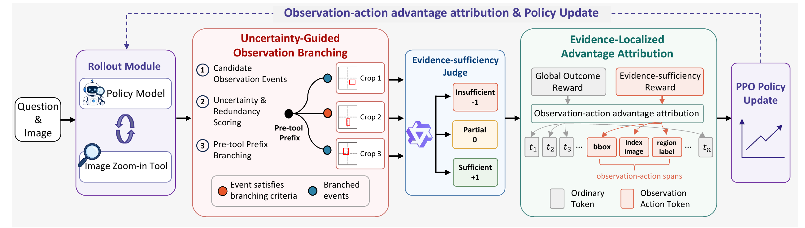

# OPO: Observation Policy Optimization

Official repository for **Learning Where to Look: Observation Policy Optimization for Thinking with Images** (NeurIPS 2026).

[🤗 Model](https://huggingface.co/Yann0122/OPO-8B) · [🤗 Training Data](https://huggingface.co/datasets/ChenShawn/DeepEyes-Datasets-47k)

## Code Release

**Code coming soon.** Training and evaluation code will be released in this repository.

## Overview

[](assets/architecture.png)

OPO learns where to look when reasoning with images through two components:

- **Uncertainty-guided Observation Branching (UOB):** explores alternative observation actions from shared reasoning prefixes.
- **Evidence-Localized Advantage Attribution (ELAA):** assigns visual evidence feedback to the corresponding observation actions.

## Citation

```bibtex
@inproceedings{wang2026opo,
  title={Learning Where to Look: Observation Policy Optimization for Thinking with Images},
  author={Wang, Junfeng and Liu, Jiawei and Xu, Yongchao and Jiang, Tao and Ai, Jiangbo and Zhang, Jin and Wang, Chong and Zhang, Qixing},
  booktitle={Advances in Neural Information Processing Systems},
  year={2026}
}
```

## Acknowledgments

Our work builds on [verl](https://github.com/volcengine/verl), [DeepEyes](https://github.com/Visual-Agent/DeepEyes), and [Qwen3-VL](https://github.com/QwenLM/Qwen3-VL).
